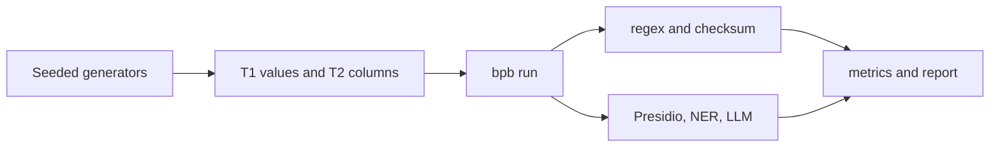

# Bharat PII Bench — Synthetic benchmark and detector for Indian personal identifiers

[](.github/workflows/ci.yml)
[](LICENSE)
[](https://test.pypi.org/project/bharat-pii/)

<!-- TODO: replace docs/demo.gif with a person-recorded leaderboard or terminal demo of bpb run. -->


## Why

Data catalogs classify columns to drive masking and access policies. Many open-source classifiers focus on Western identifier formats, and coverage of Indian identifiers is often thin. India's Digital Personal Data Protection Act has increased attention on personal-data handling, so teams that classify or mask Indian data need a transparent benchmark for those formats.

## Quickstart

On a fresh checkout, with [uv](https://docs.astral.sh/uv/) installed:

```bash
bash scripts/quickstart.sh
```

That command installs the bench extra, writes synthetic T1 and T2 data, scores the checksum detector, and regenerates the leaderboard below.

## How it works



Generators draw only from validators for Aadhaar, PAN, GSTIN, and the other taxonomy labels. `regex_checksum` applies those validators in a fixed order. A column label is the majority value label. `regex_checksum+names` breaks a tie with the column name. Presidio, NER, and the LLM are optional extras; the LLM skips a call when the next estimate would exceed `--budget-usd`.

## Results

`bpb readme` rewrites the table between the markers from `results/*/metrics.csv`. Name-sensitivity columns are the T2 macro-F1 for truthful, obfuscated, and misleading column names, and the drop from truthful.

<!-- leaderboard:start -->
| Detector | T1 macro-F1 | Truthful | Obfuscated | Misleading | Drop obfuscated | Drop misleading |
| --- | ---: | ---: | ---: | ---: | ---: | ---: |
| regex_checksum | 0.8508 | 0.8667 | 0.8667 | 0.8667 | 0.0000 | 0.0000 |
| regex_checksum+names | 0.8508 | 0.8667 | 0.8667 | 0.8667 | 0.0000 | 0.0000 |
<!-- leaderboard:end -->

## Design decisions

Recorded in [docs/adr/](docs/adr/). The dataset card is [docs/dataset-card.md](docs/dataset-card.md). Publishing to TestPyPI is [`.github/workflows/release.yml`](.github/workflows/release.yml).

## Roadmap

- Driving licence, ABHA, and ration-card labels are not in the taxonomy yet.
- `configs/bench.yaml` still has no default LLM model.

## Licence

Apache-2.0
